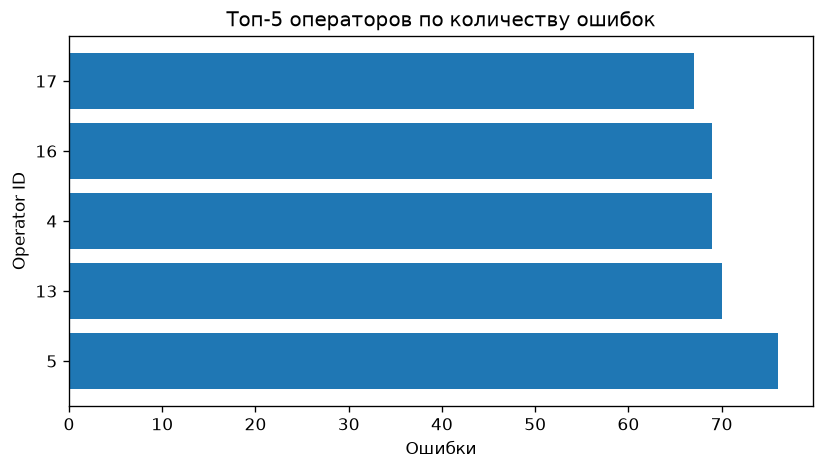
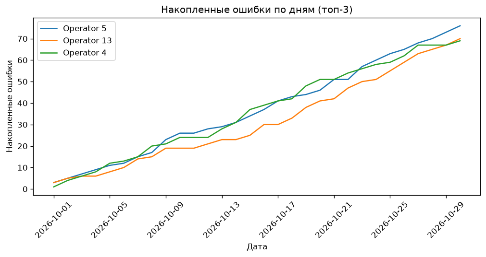

# Contact Center Quality Monitor

Учебно-портфолио проект: автоматизация поиска ошибок операторов контакт-центра.

## Бизнес-задача
Ежедневно в КЦ поступают тысячи обращений. Нужно автоматически выявлять
операторов с аномально высоким уровнем ошибок (долгие паузы, сбросы,
низкие оценки) и находить отклонения от среднего по команде.

## Стек
- **PostgreSQL 16** (в проде — GreenPlum, синтаксис совместим)
- **Python 3.14**: pandas, numpy, sqlalchemy, matplotlib
- **Docker**, Git
- **AI-ассистент** (DeepSeek) — использован для рефакторинга SQL и генерации документации

## Быстрый старт
```bash
docker compose up -d
Get-Content sql/01_schema.sql -Raw | docker compose exec -T db psql -U postgres -d cc_quality
python data/generate_data.py
python scripts/load_to_db.py
python run.py
```

## Пример работы (визуализация)
График топ-5 операторов по количеству ошибок:


Динамика накопления ошибок по дням (топ-3 худших оператора):


## Что демонстрирует проект
- SQL: оконные функции (`RANK`, `SUM OVER`), CTE, `CREATE TEMP TABLE`, индексы + `EXPLAIN ANALYZE`
- pandas: `merge`, `groupby`+`transform`, `cumsum`, `unstack`, `np.where`, `str.join`, `str.split`, `.loc/.iloc`
- Воспроизводимый пайплайн: генерация → загрузка → анализ → отчёт
- Git-flow: работа через feature-ветки и Pull Request
- Использование AI-инструментов для оптимизации и документирования

## Использование AI
- SQL-запрос из `03_analysis.sql` (раздел 2) был переписан с коррелированного
  подзапроса на CTE + окно по подсказке DeepSeek. Разница в плане — в `outputs/explain_*.txt`.
- README сгенерирован с помощью DeepSeek, затем отредактирован вручную.